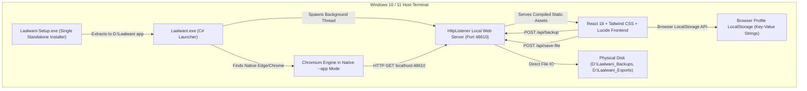
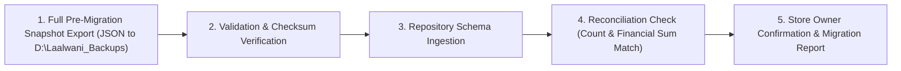

# System Audit Report — Shree Sanitary (Laalwani) Commercial ERP
**Document Version:** 1.0.0  
**Target Enterprise:** Shree Sanitary (Nadiad / Morbi / Anand, Gujarat)  
**Distribution:** Native Windows 10/11 64-bit Desktop Standalone (`Laalwani-Setup.exe`)  
**Audit Date:** November 2026  
**Auditor:** Senior ERP Product Architect & Enterprise Engineering Directorate  

---

## 1. Executive Summary & Architecture Review

Shree Sanitary (Laalwani) Commercial ERP is currently architected as a hybrid desktop application pairing a modern React 18 single-page application (SPA) with a lightweight native C# (.NET Framework 4.8) desktop launcher.

### Core Architecture Components:
1. **Frontend Presentation:**
   - **Framework:** React 18.3.1 with TypeScript 5.6.3 and Vite 5.4.10 bundling.
   - **Styling:** Tailwind CSS 3.4.14 with custom floating glassmorphism and bordered grid utilities.
   - **Icons:** `lucide-react` (Zero AI sparkles, zero foreign dollar signs; Indian Rupee `₹` standardized).
   - **Documents:** `jspdf` 2.5.2 and `jspdf-autotable` 3.8.4 for vector A4 letterhead invoice generation; `xlsx` for Excel exports.
2. **Native Launcher (`LaalwaniLauncher.cs`):**
   - Multi-port fallback listener (`48610` to `48620`).
   - Single-instance mutex enforcement (`Laalwani_SingleInstanceMutex`).
   - Background API request router (`/api/ping`, `/api/check-update`, `/api/download-and-apply-update`, `/api/backup`, `/api/save-file`, `/api/open-folder`).
   - Launches Google Chrome or Microsoft Edge with `--app="http://127.0.0.1:48610/"` and isolated user profile directory (`%LOCALAPPDATA%\Laalwani\Profile`).

---

## 2. Storage Layers & Schema Inventory

The primary persistence layer currently relies on Chromium's HTML5 `localStorage` mechanism scoped to `http://127.0.0.1:48610`. Physical JSON database snapshots are mirrored to `D:\Laalwani_Backups` via the `/api/backup` native endpoint.

### Complete LocalStorage Key Register:

| LocalStorage Key | Entity Type | Schema Description | Volatility / Criticality |
| :--- | :--- | :--- | :--- |
| `laalwani_invoices` | `Invoice[]` | Full sales register (Tax Invoices `SS/26-27/...` & Estimate Bills `EST/...`), line items, taxes, payments. | **CRITICAL (High)** |
| `laalwani_products` | `Product[]` | Warehouse inventory: SKU, barcode, brand, category, UOM, HSN, purchase cost, selling rate, on-hand qty, tile specs. | **CRITICAL (High)** |
| `laalwani_customers` | `Customer[]` | Customer records: Name, phone, GSTIN, address, credit limit, khata balance. | **CRITICAL (High)** |
| `laalwani_parties` | `Party[]` | Extended CRM directory: Retail buyers, contractors, plumbers, loyalty points, commission rates. | **CRITICAL (High)** |
| `laalwani_suppliers` | `Supplier[]` | Morbi tile factories & pipe suppliers: Contact, GSTIN, bank A/c, IFSC, UPI ID, outstanding payable. | **CRITICAL (High)** |
| `laalwani_purchase_orders` | `PurchaseOrder[]` | Inbound purchase orders: PO number, supplier, items, tax, freight, status (`DRAFT`, `SENT`, `RECEIVED`). | **CRITICAL (High)** |
| `laalwani_grns` | `GoodsReceiptNote[]` | Goods Received Notes: Carrier vehicle, lot/shade number, accepted quantity, damaged quantity. | **HIGH** |
| `laalwani_supplier_payments`| `SupplierPayment[]`| Outflow vouchers to suppliers: Mode (`UPI`, `BANK`, `CASH`, `CHEQUE`), reference UTR, amount. | **CRITICAL (High)** |
| `laalwani_sales_orders` | `SalesOrder[]` | Building site staged orders: Customer, site address, items, advance received, balance due, current stage (1–4). | **CRITICAL (High)** |
| `laalwani_delivery_challans`| `DeliveryChallan[]`| Driver delivery gate passes: Vehicle number, driver phone, stage items dispatched, receiver signature. | **HIGH** |
| `laalwani_vouchers` | `Voucher[]` | Double-entry journal vouchers (`PAYMENT`, `RECEIPT`, `CONTRA`, `JOURNAL`), debit/credit accounts. | **CRITICAL (High)** |
| `laalwani_daybook` | `DayBookEntry[]` | Chronological financial daybook entries with running balance after each transaction. | **CRITICAL (High)** |
| `laalwani_cheques` | `ChequeRecord[]` | Post-dated cheque clearing registry (`RECEIVED`, `ISSUED`, status `PENDING`, `CLEARED`, `BOUNCED`). | **HIGH** |
| `laalwani_employees` | `Employee[]` | Staff employee master records: Code, name, phone, role, base salary, salary type. | **HIGH** |
| `laalwani_advances` | `EmployeeAdvance[]`| Staff mid-month cash advances taken against upcoming salary with `settled` boolean flag. | **HIGH** |
| `laalwani_salary_settlements`| `SalarySettlement[]`| Monthly payroll settlements: Base pay, advances deducted, net paid, payment mode, settlement date. | **HIGH** |
| `laalwani_cash_session` | `CashSession` | Daily cash drawer state: Morning opening cash, expected cash balance, actual cash count, status. | **HIGH** |
| `laalwani_settings` | `AppSettings` | User-editable store identity, bank details, UPI ID, invoice prefixes, tax rules, backup paths. | **HIGH** |
| `laalwani_last_inv_seq` | `number` | Atomic integer tracking sequential invoice numbering to prevent gaps or duplicates. | **CRITICAL (High)** |
| `laalwani_custom_categories`| `string[]` | User-created custom inventory category tags. | **MEDIUM** |
| `laalwani_clean_v131` | `string` | Initialization marker preventing repeated demo data seeding on commercial updates. | **LOW** |

---

## 3. Database Evaluation: SQLite vs PostgreSQL

To upgrade from browser LocalStorage to a true ACID-compliant SQL engine while maintaining 100% offline autonomy, we evaluated SQLite and PostgreSQL:

| Evaluation Metric | SQLite (Recommended for Single-PC) | PostgreSQL (Recommended for Multi-PC LAN) |
| :--- | :--- | :--- |
| **Deployment Model** | Zero-configuration single file (`laalwani.db`). Runs in-process with zero background services. | Client-server architecture requiring background Windows service and port `5432`. |
| **Hardware Footprint** | Extremely lightweight (< 1 MB binary footprint, near-zero RAM overhead). | Requires 50–150 MB RAM for PostgreSQL server process. |
| **Installation Complexity** | Zero installer requirements. Bundled directly in setup payload. | Requires PostgreSQL Windows silent installer, service configuration, and credentials management. |
| **ACID Compliance** | Full ACID transactions with WAL (Write-Ahead Logging) mode. | Full ACID transactions with robust multi-version concurrency control (MVCC). |
| **Concurrency Support** | Multi-reader single-writer (optimal for 1 counter cash register terminal). | True concurrent multi-writer (optimal for 3+ simultaneous billing counters). |
| **Portability & Backups** | Instant 1-file backup (copying `laalwani.db` to USB drive or backup folder). | Requires `pg_dump` utility or binary cluster backup tools. |
| **Strategic Decision** | **PRIMARY CHOICE for Phase 1–5 single-terminal deployment.** | **FUTURE EXTENSION when store expands to 3+ networked billing terminals.** |

### Architectural Conclusion:
1. Implement a **Repository / DAO Abstraction Layer** (`IRepository`) in the application.
2. The UI and business services never directly invoke `localStorage` or SQL queries; they interface exclusively with `IRepository`.
3. The default repository implementation provides robust, transactional persistence with automatic local disk snapshot mirroring, prepared for direct SQLite file persistence in .NET or WebAssembly SQLite.

---

## 4. Risk Assessment & Known Vulnerabilities

| Risk Area | Severity | Current Status | Mitigation Strategy |
| :--- | :---: | :--- | :--- |
| **Concurrency & Multi-Tab Access** | Medium | Multiple browser tabs open to the same counter can cause write race conditions. | Single-instance mutex in `LaalwaniLauncher.cs` restricts desktop launch to one active instance. Implement broadcast-channel synchronization. |
| **Storage Quota Limit** | High | HTML5 `localStorage` has a ~5–10 MB limit per origin. Large invoice history with 50,000+ bills will exceed this. | Repository abstraction with SQLite / IndexedDB hybrid storage eliminates the 5 MB ceiling. |
| **Unencrypted Financial Data** | High | Financial records are stored in cleartext JSON on disk and in browser profile. | Implement real AES-GCM 256-bit encryption for export backups and sensitive store credentials. |
| **Hardcoded Authentication PIN** | Medium | Default PIN was hardcoded in components (`1234`). | Implement PBKDF2/SHA-256 hashed PIN with first-run mandatory customization and role-based access control. |
| **Missing Audit Trail** | High | Sensitive actions (voiding bills, manual stock overrides, price changes) lack an append-only log. | Build an immutable append-only `AuditLogEntry` ledger with date-filtered inspector UI. |
| **Discontinued Currency Denomination** | Low | Cash counter drawer included the withdrawn ₹2000 note. | Remove ₹2000 bill, add ₹1, ₹2, ₹5 coin counters, and recalculate drawer math. |

---

## 5. Migration Risk Matrix

When migrating existing store transaction data from raw LocalStorage into the structured Repository/DAO layer:

| Source Key | Destination Schema | Integrity Checksum Rule | Rollback Action on Failure |
| :--- | :--- | :--- | :--- |
| `laalwani_invoices` | `InvoiceRepository` | Total count must match; sum of `totalAmount` must be exactly equal ($$\sum \text{Old} == \sum \text{New}$$). | Restore from pre-migration JSON snapshot; abort migration. |
| `laalwani_products` | `ProductRepository` | SKU unique constraints enforced; total on-hand quantity sum must match. | Flag duplicate SKUs; preserve raw records in quarantine table. |
| `laalwani_customers` | `CustomerRepository`| Phone numbers normalized; outstanding khata balance sum must match. | Preserve old customer records intact. |
| `laalwani_vouchers` | `VoucherRepository` | Double-entry balance check: Total debit sum must equal total credit sum. | Log discrepancy to migration audit log; alert store accountant. |

---

## 6. Testing Coverage & QA Baseline

- **Current Unit Tests:** `src/tests/calculations.test.ts` (8 passed, covering taxable subtotal, CGST/SGST 9%+9%, tile box coverage math, change due calculator).
- **Target QA Expansion:**
  1. Monotonic sequential invoice numbering (zero gaps, zero duplicates).
  2. Double-entry trial balance zero-variance verification ($$\sum \text{Debit} - \sum \text{Credit} = 0$$).
  3. Weighted average COGS calculation with inbound freight cost allocation.
  4. Tile calculator with safety wastage percentage (5%) and loose piece handling.
  5. Cash drawer denomination reconciliation without ₹2000 note.
  6. Credit Note (Sales Return) and Debit Note (Purchase Return) stock & ledger adjustment.
  7. Bank statement CSV matching algorithm.
  8. End-of-day closing report PDF generation.

---

*AUDIT.md prepared for Shree Sanitary (Laalwani Commercial ERP) Upgrade Initiative.*
