# Implementation Plan — Shree Sanitary (Laalwani) ERP Commercial Upgrade
**Upgrade Plan Target:** Robust Offline-First Desktop ERP, Resilient Storage Architecture, Capsule-Style UI, Automated OCR/CSV Ingestion & Enterprise Testing.  
**Version Target:** v2.0.0 Commercial Release  
**Execution Date:** November 2026  

---

## Architecture & Design Roadmap

```mermaid
graph TD
    subgraph Phase1["Phase 1: Data & Storage Foundation"]
        P1_1["Repository / DAO Abstraction Layer"]
        P1_2["Data Migration Service & Verification"]
        P1_3["Scheduled & EOD Backup Engine"]
        P1_4["Genuine WebCrypto AES-GCM Encryption"]
    end

    subgraph Phase2["Phase 2: Security, Roles & Audit Logging"]
        P2_1["Role-Based Access Control (Owner, Accountant, Cashier)"]
        P2_2["Hashed PIN Authentication with Salt"]
        P2_3["Append-Only Audit Log Ledger & Viewer"]
    end

    subgraph Phase3["Phase 3: Accounting, Returns & GST Compliance"]
        P3_1["Sales Returns / Credit Notes (CN/26-27/...)"]
        P3_2["Purchase Returns / Debit Notes (DN/26-27/...)"]
        P3_3["Full Ledger Reports & Trial Balance Engine"]
        P3_4["GSTR-1 Excel/JSON Export & e-Way Threshold Alert"]
        P3_5["Weighted Average COGS Engine"]
    end

    subgraph Phase4["Phase 4: Inventory, Orders & Cash Drawer"]
        P4_1["Tile Lot / Shade Tracking & Multi-Lot Warning"]
        P4_2["Tile Calculator Wastage % (5%) & Loose Pieces"]
        P4_3["Site Orders Partial Item Dispatch Tracking"]
        P4_4["1-Click Workflow (Estimate -> Order -> Challan -> Invoice)"]
        P4_5["Cash Drawer: Remove ₹2000, Add ₹1/₹2/₹5 Coins"]
    end

    subgraph Phase5["Phase 5: Document OCR, Imports & Automations"]
        P5_1["Tesseract OCR Invoice/Challan Text Scanning"]
        P5_2["Document Import Wizard with Field Auto-Population"]
        P5_3["Bulk Excel/CSV Import Wizard with Column Mapping"]
        P5_4["Bank Statement CSV Auto-Reconciler (UTR/Amount)"]
        P5_5["Automated Low-Stock Purchase Order Drafting"]
        P5_6["Trilingual Khata WhatsApp Payment Reminders"]
        P5_7["Automated End-of-Day PDF Closing Report"]
        P5_8["Customer Tier Pricing Rules & Loyalty Redemption"]
    end

    subgraph Phase6["Phase 6: UI Architecture, Capsule Design & QA"]
        P6_1["Refactor to /src/pages/ with Matching PascalCase Filenames"]
        P6_2["Capsule-Style UI Theme (Pill Tabs, Filters, Buttons, Statuses)"]
        P6_3["Comprehensive Unit Test Suite Expansion"]
        P6_4["Installer Build & Rollback Verification"]
    end

    Phase1 --> Phase2
    Phase2 --> Phase3
    Phase3 --> Phase4
    Phase4 --> Phase5
    Phase5 --> Phase6
```

---

## Phased Execution Breakdown

### Phase 1: Data & Storage Foundation
1. **Repository Abstraction (`src/services/repository/`):**
   - Define `IRepository<T>` and specialized repositories (`IInvoiceRepository`, `IProductRepository`, `ICustomerRepository`, `IVoucherRepository`, etc.).
   - Implement `LocalStorageRepository` implementing all repository interfaces with disk backup synchronization.
   - Refactor `StorageService` to delegate all persistence through the repository layer.
2. **Data Migration Service (`src/services/migration.ts`):**
   - Automatically checks database version.
   - Generates pre-migration snapshot in `D:\Laalwani_Backups\pre_migration_*.json`.
   - Ingests legacy LocalStorage records into structured schemas.
   - Computes checksums: total bills count, total sales sum, stock on-hand count.
   - Generates a verified Migration Report.
3. **Backup & Restore System:**
   - Scheduled daily backup at 21:00.
   - End-of-day automatic backup on cash register closing.
   - Startup backup integrity verification.
   - Interactive Restore screen in Settings with Owner PIN confirmation and USB directory scanning.
4. **Encryption Layer (`src/services/crypto.ts`):**
   - Authentic Web Crypto AES-GCM 256-bit encryption for export snapshots and sensitive banking/license keys.

---

### Phase 2: Security, Roles & Audit Logging
1. **Role-Based Access Control (RBAC):**
   - Roles: `OWNER`, `ACCOUNTANT`, `CASHIER`.
   - Role permissions table in `src/types/index.ts`.
   - Route and feature guards (e.g. Cashier cannot delete items, view company bank credentials, or wipe records).
2. **Hashed PIN Authentication:**
   - Cryptographic hashing (PBKDF2 / SHA-256 with store salt).
   - Change PIN modal in Settings with old PIN verification.
3. **Append-Only Audit Log:**
   - Schema: `AuditLogEntry` (`timestamp`, `userId`, `action`, `entityType`, `entityId`, `details`, `oldValue`, `newValue`).
   - Audit Log Inspector tab in Settings with search and date filters.

---

### Phase 3: Accounting, Returns & GST Compliance
1. **Sales Return (Credit Note):**
   - Numbering: `CN/26-27/0001`.
   - Restores returned items to live inventory.
   - Creates double-entry credit voucher: Debit Sales Return, Credit Customer Khata (or Cash/Bank).
2. **Purchase Return (Debit Note):**
   - Numbering: `DN/26-27/0001`.
   - Deducts returned goods from live inventory.
   - Creates debit voucher: Debit Supplier Payable, Credit Purchase Return.
3. **Full Financial Reports:**
   - General Ledger, Trial Balance, Profit & Loss, Balance Sheet, Cash & Bank Book.
   - Automated balancing validation ($$\sum \text{Debit} - \sum \text{Credit} == 0$$).
4. **GST Enhancements:**
   - HSN validation & state-wise tax split (CGST+SGST vs IGST).
   - GSTR-1 Excel export & GSTN JSON export.
   - Pure separation of Estimate bills (`EST/`) from GST reports.
   - e-Way bill threshold alert (> ₹50,000).
5. **Weighted Average COGS Engine:**
   - Freight & loading charges allocation to purchase unit cost.

---

### Phase 4: Inventory, Orders & Cash Drawer
1. **Batch/Lot & Shade Tracking:**
   - GRN captures tile lot/shade. Live stock tracks available batches.
   - Billing alerts cashier if multiple different shades are selected for the same room.
2. **Tile Calculator Wastage % & Loose Pieces:**
   - Default 5% wastage calculation. Support for loose tiles.
3. **Site Orders Partial Item Dispatch:**
   - Tracks `orderedQty`, `dispatchedQty`, and `balanceQty` per SKU.
   - Material return to warehouse.
   - 1-click sequence: Estimate → Site Order → Delivery Challan → Tax Invoice.
4. **Cash Drawer Indian Denominations:**
   - Discontinue ₹2000.
   - Add ₹500, ₹200, ₹100, ₹50, ₹20, ₹10 notes and ₹20, ₹10, ₹5, ₹2, ₹1 coins.

---

### Phase 5: Document OCR, Imports & Automations
1. **Tesseract OCR Scanning:**
   - Upload invoice/challan image/PDF.
   - Extract text, parse fields (Invoice No, Date, Vendor, Totals) via regex.
   - Display Confidence Score & manual review wizard.
2. **Bulk Excel/CSV Import Wizard:**
   - Products, Customers, Opening Balances with column mapping and row validation.
3. **Bank Statement CSV Matching:**
   - Reconciles bank/UPI statement against pending transactions by UTR/Amount.
4. **Low-Stock Automatic PO Drafting:**
   - Groups low-stock items by supplier and proposes reorder quantities.
5. **Khata WhatsApp Payment Reminders:**
   - One-click WhatsApp links (`wa.me/?text=...`) in Gujarati, English, and Hindi.
6. **End-of-Day PDF Summary:**
   - Automatically generates daily closing report.
7. **Customer Tier Pricing & Loyalty Redemption:**
   - Auto-apply contractor/plumber pricing and redeem loyalty points as cash discount.

---

### Phase 6: UI Architecture, Capsule Design & QA
1. **Folder Organization:**
   - Standardize all screens under `src/pages/` with PascalCase filenames (`DashboardPage.tsx`, `BillingPage.tsx`, `ReturnsPage.tsx`, `ImportPage.tsx`, etc.).
2. **Capsule-Style UI ("USE YOUR BEST FRONTEND PLZ...YOU TRY CAPSULE TYPE ..."):**
   - Capsule navigation pills with high-contrast active states.
   - Rounded-full pill filters and status indicators.
   - Sleek capsule buttons and high-density bordered financial panels.
3. **Comprehensive Unit Tests:**
   - Expand `src/tests/` to verify all new business and accounting calculations.
4. **Standalone Packaging:**
   - Update `Laalwani-Setup.exe` with new binaries.

---

*PLAN.md prepared for Shree Sanitary (Laalwani Commercial ERP) Upgrade Initiative.*
