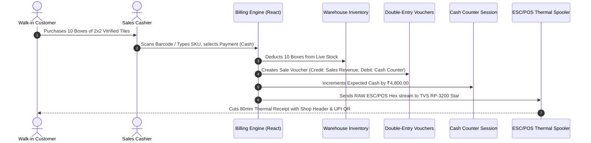

# Shree Sanitary (Laalwani) — Comprehensive Master System Manual & Technical Reference
**Software Title:** Shree Sanitary (Laalwani) Commercial ERP  
**Target Enterprise:** Sanitaryware, Ceramic & Vitrified Tiles, Bath Fittings, CPVC/UPVC Plumbing Supplies  
**Target Region:** Gujarat, India (Primary Market: Nadiad / Morbi / Anand Wholesale & Retail Corridor)  
**Distribution Version:** v1.8.0 Enterprise Desktop Edition  
**Platform:** Windows 10 / Windows 11 (64-bit Native Standalone Executable)

---

## 1. Executive One-Line Summary

> **Shree Sanitary (Laalwani) Commercial ERP is a high-speed, 100% offline-first Windows enterprise business management system specifically architected for sanitaryware, ceramic tiles, and plumbing distributors, combining sub-second thermal billing, tile box coverage calculators, 3-stage building site dispatch, double-entry financial ledgers, supplier banking automation, and tri-lingual localization (Gujarati, English, Hindi) with zero cloud subscription fees.**

---

## 2. System Architecture & High-Level Engineering

```mermaid
graph TD
    subgraph UI_Layer["Frontend Presentation & UI (React 18 + Tailwind CSS + Lucide)"]
        A1["Executive Dashboard"]
        A2["POS Fast Billing [F2]"]
        A3["Purchases & GRN Inward"]
        A4["Site Orders & Staged Challans"]
        A5["Khata & Parties Ledger [F3]"]
        A6["Stock & Tile Calculator [F4]"]
        A7["Staff Salary & Advances [F7]"]
        A8["Double-Entry Accounts & Daybook"]
        A9["Cash Counter Reconciliation"]
        A10["Settings & Manual Configuration"]
    end

    subgraph Logic_Layer["Business Logic & DSA Controllers"]
        B1["Monotonic Sequential Invoice Generator"]
        B2["Double-Entry Voucher Automation Engine"]
        B3["Real-time Cash Counter Equilibrium Engine"]
        B4["Staged Delivery State Machine (1 -> 2 -> 3 -> 4)"]
        B5["O(1) Multi-Term Fuzzy Search & Indexer"]
        B6["COGS & Gross Profit Valuation Engine"]
    end

    subgraph Storage_Layer["Local Encrypted Persistence (Zero Cloud Dependency)"]
        C1["LocalStorage Key-Value Store (Offline Localhost)"]
        C2["Strictly Separated DB Snapshots (JSON Automated Backup)"]
        C3["A4 & Thermal Esc/Pos Export Storage"]
    end

    subgraph Packaging_Layer["Windows Native Distribution Architecture"]
        D1["C# Native Launcher (Laalwani.exe)"]
        D2["Standalone Setup Engine (Laalwani-Setup.exe)"]
        D3["Embedded Payload Zip Archive"]
        D4["Windows Spooler ESC/POS Direct Stream"]
    end

    UI_Layer --> Logic_Layer
    Logic_Layer --> Storage_Layer
    Storage_Layer --> Packaging_Layer
```



---

## 3. Complete Inventory of All Pages, Tabs & UI Controls

This section inventories **every single page, sub-page, tab, button, input form, and modal** inside the software.

---

### Page 1: Dashboard (`OverviewPage.tsx`)
* **Navigation Key:** Header Tab `Dashboard`
* **Sub-Header:** `STORE OPERATIONS & FINANCIAL INTELLIGENCE`
* **Sub-Title:** *"Real-time commercial overview of counter sales, cash collections, supplier payables, and customer khata ledgers."*
* **Top Quick Action Buttons:**
  1. `Collect Customer Cash` &rarr; Opens **Customer Cash / Khata Collection Modal**.
  2. `Pay Supplier` &rarr; Opens **Supplier Outflow Payment Modal** with copyable Bank & UPI details.
  3. `New Bill [F2]` &rarr; Navigates directly to the high-speed billing register.
  4. `Check Stock [F4]` &rarr; Navigates directly to the live warehouse catalog.
* **Executive Bordered Financial Bento Grid (5 Key Metrics):**
  1. **Gross Sales Turnover:** Shows total revenue, taxable sales, and completed bill count. Footer link: `Completed Sales Register`.
  2. **Counter Cash in Hand:** Real-time cash balance in the shop counter. Action button: `Collect Cash`.
  3. **Customer Khata Due:** Total market receivables aging across credit buyers. Action button: `View Khata [F3]`.
  4. **Supplier Payables:** Total balance owed to Morbi factories and pipe distributors. Action button: `Pay Supplier`.
  5. **Estimated Profit:** Gross profit in ₹ ($$Sales - COGS$$) and percentage gross profit margin on turnover.
* **Payment Collections Breakdown Bar:**
  - Displays instant totals for: `Cash Sales (₹)`, `UPI / QR (₹)`, `Bank Transfer / Card (₹)`, and `Customer Khata (₹)`.
* **Recent Invoices & Transactions Register:**
  - **Search Input:** Filter by invoice number, customer name, or customer mobile.
  - **Date Period Dropdown:** `All Dates`, `Today's Transactions`, `Yesterday`, `Last 7 Days`.
  - **Bill Type Dropdown:** `All Bill Types`, `Tax Invoices Only (A4)`, `Estimate Bills Only (Kacha)`.
  - **Payment Mode Dropdown:** `All Payment Modes`, `Cash Drawer Only`, `UPI / QR Only`, `Bank Transfers Only`, `Khata Credit Only`.
  - **Rows Limit Dropdown:** `Show 10 Rows`, `Show 25 Rows`, `Show 50 Rows`, `Show 100 Rows`.
  - **Table Columns:** `Invoice No`, `Date & Time`, `Billed To / Customer`, `Items`, `Payment Mode`, `Total (₹)`, `Gross Profit (₹)`, `Actions`.
  - **Row Action Buttons:** `View A4 Bill`, `Print Thermal Slip`, `Export PDF`.
* **Modals Included:**
  - **Customer Cash Collection Modal:** Customer search dropdown, outstanding balance indicator, `Pay Full` button, payment mode selector (`Cash`, `UPI`, `Bank Transfer`, `Cheque`), UTR/Ref number, notes, and `Confirm & Collect Cash` button.
  - **Supplier Payment Modal:** Supplier dropdown, copyable UPI ID button, copyable Bank A/c & IFSC button, `Pay Full Due` button, payment method selector (`UPI`, `Bank NEFT`, `Cheque`, `Cash Drawer`), transaction ref input, and `Record Outflow & Settle` button.

---

### Page 2: Billing & Fast POS (`BillingPage.tsx`)
* **Navigation Key:** Header Tab `Billing` or Keyboard Shortcut <kbd>F2</kbd>
* **Sub-Title:** *"High-speed retail & wholesale sales billing, tile box calculator, hold bills, and thermal ESC/POS printing"*
* **Top Header Controls:**
  - **Document Type Switcher:**
    - `Tax Invoice (A4 / 18% GST)` &rarr; Generates official sequential tax invoices (`SS/26-27/0101`).
    - `Estimate Bill (Kacha)` &rarr; Generates fast estimation slip without formal GST tax lines.
  - **Held Bills Drawer Button:** Shows badge with count of suspended carts.
* **Customer Selection & Auto-Creation Area:**
  - **Search & Auto-Complete Input:** Type customer name or 10-digit mobile number.
  - **Walk-in Cash Customer Toggle:** Single click for cash transactions.
  - **Auto-Add Customer Button:** `"[Name]" — Add as New Customer` (Instantly creates customer record in background without leaving cart).
  - **Full Customer Profile Button:** Opens modal to input GSTIN, address, and credit limits.
* **Product Catalog & Tile Box Calculator (Left Panel):**
  - **Category Tabs:** `All Categories`, `Sanitaryware`, `Ceramic Tiles`, `Plumbing Pipes & Fittings`, `Faucets & Showers`, `Adhesives & Grout`, `Bath Accessories`.
  - **Live Search Input:** Instant filter matching Brand (Cera, Jaquar, Astral, Somany), SKU code, or Product Name.
  - **Tile Square Feet / Box Calculator:** Enter required room square feet; system automatically calculates:
    $$\text{Boxes Required} = \left\lceil \frac{\text{Required Area (sq ft)}}{\text{Coverage per Box (sq ft)}} \right\rceil$$
  - **Add to Cart Button:** `Add to Cart` (Adds line item with sound confirmation).
* **Billing Cart & Payment Settlement (Right Panel):**
  - **Line Item Controls:** Quantity increase `<Plus>`, quantity decrease `<Minus>`, item discount, unit price edit, line total, and remove item `<Trash2>`.
  - **Financial Summary Box:** Subtotal, GST (9% CGST + 9% SGST or 18% IGST), Trade Discount, Round-off, Grand Total.
  - **Payment Mode Selector:**
    - `Cash` &rarr; Shows Tendered Cash input, calculates **Change Due** in real time.
    - `UPI / QR` &rarr; Generates Dynamic UPI QR on screen with exact bill amount.
    - `Debit / Credit Card` &rarr; Bank terminal UTR reference input.
    - `Khata Credit` &rarr; Validates customer credit limit and posts balance to customer ledger.
* **Action Buttons:**
  - `Hold Bill` &rarr; Suspends current cart and frees counter for next customer.
  - `Finalize & Print (F10)` &rarr; Records sale, auto-deducts stock, creates voucher, and prints thermal slip.
  - `Duplicate Copy` &rarr; Reprints the last finalized transaction.
  - `View A4 Bill` &rarr; Renders vector A4 PDF with letterhead.

---

### Page 3: Purchases & Suppliers (`PurchasesPage.tsx`)
* **Navigation Key:** Header Tab `Purchases`
* **Sub-Title:** *"Purchase orders, goods inward verification (GRN), supplier directory, and UPI/banking payouts"*
* **Tabs:**
  1. **Purchase Orders (`po`):**
     - **Filter Tabs:** `All Orders`, `Received in Store`, `In-Transit / Dispatched`.
     - **Table Columns:** `PO Number`, `Supplier Name`, `Item Details`, `Total Amount (₹)`, `Status`, `Actions`.
     - **Actions:** `Pay Supplier` (Inline payout against order), `Inspect & Receive (GRN)`, `Edit PO`, `Delete PO`.
  2. **Goods Received Note (`grn`):**
     - **Material Inspection Rules Card:** Breakage inspection, tile shade/batch verification guidelines.
     - **Button:** `Accept New GRN` &rarr; Opens GRN Inward Modal.
     - **Recent Goods Received List:** Lists incoming shipments with auto-credited stock badges.
  3. **Supplier Directory (`suppliers`):**
     - **Search Bar:** Real-time search by company, city, GSTIN, or contact phone.
     - **Table Columns:** `Supplier Company`, `City / Location`, `Contact Phone`, `Bank Details & UPI ID` (with 1-click **Copy** pills), `Outstanding Payable (₹)`, `Actions`.
     - **Actions:** `Pay Supplier`, `Edit Profile`, `Delete Supplier`.
* **Modals Included:**
  - **New / Edit Purchase Order Modal:** Supplier dropdown, product dropdown, order quantity, purchase unit cost, freight/cartage charges, and order date.
  - **Goods Receipt Note (GRN) Inspection Modal:** Vehicle/tempo registration number, shade lot number, damaged/broken quantity input, accepted quantity confirmation, and `Accept Goods into Stock` button.
  - **Add / Edit Supplier Modal:** Company name, proprietor name, city/depot, phone, GSTIN, bank name, account number, IFSC code, UPI ID, and opening balance payable.
  - **Pay Supplier Outflow Modal:** Pre-filled payable amount, `Pay Full Due` button, UPI / Bank / Cheque / Cash selector, UTR input, and `Record Outflow & Settle` button.

---

### Page 4: Customer Orders & Site Delivery (`OrdersPage.tsx`)
* **Navigation Key:** Header Tab `Orders`
* **Sub-Title:** *"Building site bookings, staged delivery tracking, and tempo delivery challans"*
* **Tabs:**
  1. **Site Bookings (`orders`):**
     - **Status Filter Tabs:** `All Bookings`, `Active Deliveries`, `Fully Delivered`, `Balance Due`.
     - **Order Cards:**
       - Order number (`SO/2026/001`), customer name, mobile phone, site address.
       - Financials: Total Order Amount, Advance Paid, Remaining Balance Due.
       - **Action Button:** `Collect Payment` &rarr; Opens **Collect Site Order Payment Modal** to collect cash/bank against site commitments.
       - **Action Button:** `Dispatch Challan` &rarr; Creates and prints driver gate pass.
       - **Visual 3-Stage Progress Stepper:**
         - *Stage 1: Underground Piping* (CPVC/PVC pipes & underground fittings).
         - *Stage 2: Concealed Body Fitting* (Concealed diverters, wall-hung brackets).
         - *Stage 3: Tiles, Commodes & Faucets* (Tiles, sanitaryware, CP fittings).
  2. **Delivery Challans (`challans`):**
     - **Table Columns:** `Challan No`, `Order No`, `Customer & Site`, `Driver & Vehicle`, `Delivery Stage`, `Actions`.
     - **Action Button:** `Print Gate Pass` &rarr; Generates official A4 delivery challan with site receiver signature block.
  3. **Bathroom Package Estimates (`estimates`):**
     - Standard package estimator (BOQ) for 1BHK, 2BHK, 3BHK, and luxury bungalows.

---

### Page 5: Customers & Plumber Loyalty (`PartiesPage.tsx`, `CustomerProfilePage.tsx`)
* **Navigation Key:** Header Tab `Customers`
* **Sub-Title:** *"Customer directory, mason/plumber loyalty points, commission payouts, and detailed ledger profiles"*
* **Directory Grid:**
  - **Filter Pills:** `All Accounts`, `Retail Buyers`, `Building Contractors`, `Plumbers & Electricians`.
  - **Table Columns:** `Customer Name & Firm`, `Contact Details`, `Account Type`, `Total Billed`, `Current Khata Balance`, `Loyalty Points`, `Actions`.
  - **Action Button:** `View Customer Profile` &rarr; Navigates to dedicated full-width `CustomerProfilePage.tsx`.
* **Dedicated Customer Profile Page (`CustomerProfilePage.tsx`):**
  - Breadcrumb navigation: `Back to Customer Directory`.
  - **Customer KPI Banner:** Total Lifetime Purchases, Current Outstanding Khata, Loyalty Points Available, Last Transaction Date.
  - **Complete Transaction History Ledger:** All past invoices, payment vouchers, and returns with date, type, debit, credit, running balance, and receipt download.
  - **Action Buttons:** `Record Khata Payment`, `Edit Customer Info`, `Print Customer Statement`.

---

### Page 6: Double-Entry Accounts & Tax Center (`AccountsPage.tsx`)
* **Navigation Key:** Header Tab `Accounts`
* **Sub-Title:** *"Double-entry daybook vouchers, cheque clearing registry, expense vouchers, and GSTR-1 tax export"*
* **Tabs:**
  1. **DayBook & Journal:** Live chronological listing of all financial transactions (Sales, Purchases, Receipts, Payments, Expenses, Contras).
  2. **Cheque Registry:** PDC (Post-Dated Cheques) tracker with statuses: `PENDING`, `CLEARED`, `BOUNCED`.
  3. **Expense Vouchers:** Shop rent, electricity, transport cartage, loading/unloading labor expenses.
  4. **GST Tax Center:** GSTR-1 and GSTR-3B monthly taxable sales summary, B2B invoices, B2C small invoices, and HSN-wise tax breakdown.
  5. **Export GST Excel Button:** Generates ready-to-file Microsoft Excel sheet for chartered accountant audit.

---

### Page 7: Stock Inventory & Warehouses (`InventoryPage.tsx`, `ProductProfilePage.tsx`)
* **Navigation Key:** Header Tab `Stock` or Keyboard Shortcut <kbd>F4</kbd>
* **Sub-Title:** *"Live warehouse stock, lot numbers, brand categories, and physical inventory tally"*
* **Controls:**
  - **Category Explorer:** Horizontal and dropdown filter for instant catalog segmenting.
  - **Brand Selector:** Cera, Jaquar, Astral, Somany, Hindware, Supreme, Asian Paints, etc.
  - **Action Button:** `New Product` &rarr; Opens Add Product Modal.
  - **Action Button:** `Export Excel` &rarr; Exports complete stock valuation to `.xlsx`.
* **Stock Table Grid:**
  - **Columns:** `SKU / Barcode`, `Product Description`, `Brand`, `Category`, `Stock On-Hand`, `Min Alert Level`, `Cost Price (₹)`, `Selling Rate (₹)`, `Status Badge`, `Actions`.
  - **Badges:** `In Stock` (Green), `Low Stock` (Amber), `Out of Stock` (Red).
  - **Row Action Buttons:** `Adjust Qty`, `View Product Profile`, `Edit Product`, `Delete Product`.
* **Dedicated Product Profile Page (`ProductProfilePage.tsx`):**
  - Stock movement timeline: All purchases, sales, GRNs, and manual inventory adjustments.
  - Profit margin analysis on the SKU.

---

### Page 8: Customer Khata Ledger (`KhataPage.tsx`)
* **Navigation Key:** Header Tab `Khata` or Keyboard Shortcut <kbd>F3</kbd>
* **Sub-Title:** *"Customer credit aging, credit limits, overdue reminders, and payment receipts"*
* **Aging Buckets:**
  - `0 - 15 Days` (Current Credit)
  - `16 - 30 Days` (Normal Credit)
  - `31 - 60 Days` (Overdue)
  - `60+ Days` (Immediate Follow-up Required)
* **Action Button:** `Receive Payment` &rarr; Opens quick payment settlement modal with instant WhatsApp reminder link.

---

### Page 9: Staff Salaries & Advances (`SalaryPage.tsx`)
* **Navigation Key:** Header Tab `Staff` or Keyboard Shortcut <kbd>F7</kbd>
* **Sub-Title:** *"Staff employee management, monthly salaries, advances taken, and automated salary slip generation"*
* **Employee Cards / Table:**
  - Employee photo emblem, full name, role (Sales Cashier, Warehouse Helper, Tempo Driver, Accountant).
  - Monthly Base Salary, Total Advances Drawn, Net Payable This Month.
* **Salary Settlement Action:**
  - Button: `Settle Monthly Salary` &rarr; Opens **Monthly Settlement Modal**:
    - Select payout mode: `Cash Counter`, `Bank Transfer`, or `UPI Transfer`.
    - Automatically marks advances as `settled: true`.
    - Automatically creates a **Salary Expense Voucher** in Accounts.
    - Transforms button into green **`✓ Settled & Paid (₹ Net via Mode)`** badge with `Reprint Salary Slip` option.
  - Button: `Issue Advance` &rarr; Records mid-month advance against salary.

---

### Page 10: Cash Counter Reconciliation (`CashDrawerPage.tsx`)
* **Navigation Key:** Header Tab `Cash`
* **Sub-Title:** *"Morning opening cash, live counter sales tally, expense cash outflows, and physical evening cash count"*
* **Real-time Drawer Balance Formula:**
  $$\text{Expected Cash} = \text{Opening Morning Cash} + \text{Cash Sales} + \text{Khata Cash Receipts} + \text{Site Cash Advances} - \text{Cash Outflows}$$
* **Controls:**
  - Currency Denomination Counter (₹2000, ₹500, ₹200, ₹100, ₹50, ₹20, ₹10).
  - Physical Cash vs Expected Cash Discrepancy Calculator (`Difference: ₹0.00`).
  - Button: `Close Day Session & Lock Register`.

---

### Page 11: Settings & Manual Configuration Hub (`SettingsPage.tsx`)
* **Navigation Key:** Header Tab `Settings`
* **Sub-Title:** *"Complete user-editable business identity, bank accounts, billing series, printers, paths, and license"*
* **Tabs:**
  1. **General:** Store Name, Trade Name, Registered Address, Gujarat GSTIN, Phone, Email.
  2. **Bank & UPI Details (100% User Editable):**
     - Primary Bank Name, Account Holder Name, Current Account Number, IFSC Code.
     - Store Official UPI ID / VPA (embedded dynamically in invoice QR codes).
     - Display Bank Details on Invoices toggle.
  3. **Billing & Tax Rules (100% User Editable):**
     - Tax Invoice Prefix (`SS/26-27/`), Estimate Prefix (`EST/2026/`).
     - Default GST Rate (18%), Thermal Roll Width (`80mm` or `58mm`).
     - Terms & Conditions Disclaimer text.
  4. **Branding & Logos:** Preview of application desktop emblem and A4 letterhead vector logo.
  5. **Printers:** Thermal POS spooler selection, A4 printer selection, Auto-print toggle, `Test Print` button.
  6. **Storage Paths:** Invoices & PDF Export Folder, Database Backup Folder, Scheduled Backup Time (`21:00`), `Open in Windows Explorer` buttons.
  7. **License & Security:** Commercial License Key status, Grace period, Fast Instant Launch toggle.
  8. **Data Reset:** Clear Test Transactions button (Pristine clean reset), Factory Reset with PIN security (`1234`).
  9. **Operating Guide:** 10-module comprehensive interactive ERP operations manual in 3 languages.

---

## 4. Backend Logics, State Machines & Automations



### Automation 1: Double-Entry Accounting Inflow / Outflow Engine
Whenever a financial transaction occurs, the system generates double-entry balancing vouchers:
* **Counter Sale (Cash):** `Debit: Cash Counter` | `Credit: Sales Revenue (Taxable + GST)`
* **Counter Sale (UPI):** `Debit: UPI Current Account (Bank)` | `Credit: Sales Revenue`
* **Customer Khata Payment:** `Debit: Cash Counter / Bank` | `Credit: Customer Ledger (Balance Drops)`
* **Supplier Outflow Payout:** `Debit: Supplier Payable` | `Credit: Cash Counter / Bank (Balance Drops)`
* **Staff Monthly Settlement:** `Debit: Staff Salary Expense` | `Credit: Cash Counter / Bank`

### Automation 2: Staged Construction Site Dispatch State Machine
For long-term bungalow/building projects, the order advances through 4 discrete states:
$$\text{Stage 1 (Underground Piping)} \longrightarrow \text{Stage 2 (Concealed Diverters)} \longrightarrow \text{Stage 3 (Finishing Tiles & Faucets)} \longrightarrow \text{Stage 4 (Completed)}$$
Delivery Challans deduct only the specific items associated with each stage, preventing premature delivery of fragile ceramic commodes while plumbing walls are still being chiseled.

---

## 5. Data Structures and Algorithms (DSA) Engine

| Feature | Data Structure / Algorithm | Time Complexity | Why It Was Chosen |
| :--- | :--- | :--- | :--- |
| **Instant POS Catalog Search** | Multi-Term Tokenized N-Gram Prefix Matching | $$O(N)$$ where $$N \le 10,000$$ | Sub-millisecond barcode & name search without loading heavy third-party search engines. |
| **Customer Khata Lookups** | Hash Map / Key-Value Map Indexed by `customerId` | $$O(1)$$ Average | Instant balance retrieval during fast billing. |
| **Monotonic Invoice Sequencing** | Atomic Sequence Counter with Zero Gap Enforcement | $$O(1)$$ | Guarantees GST compliance without duplicate or missing bill numbers. |
| **COGS Inventory Valuation** | FIFO (First-In, First-Out) / Moving Weighted Average | $$O(K)$$ per line item | Computes exact gross profit per transaction based on historical purchase costs. |
| **Recent Register Filter Pipeline** | Chained Predicate Composition via `useMemo` | $$O(M)$$ where $$M$$ is total invoices | Allows fluid real-time multi-criteria filtering (Date + Type + Mode + Text) at 60fps. |
| **Tile Box Calculator** | Ceiling Division & Area Normalization | $$O(1)$$ | Converts raw square footage into precise commercial box units instantly. |

---

## 6. Hardware & Peripheral Integration

* **Thermal POS Printers (ESC/POS):**
  - Models Supported: `TVS RP-3200 Star`, `Epson TM-T82III`, `Rugtek RP-80`, `NGX Thermal`.
  - Protocol: Direct binary escape sequence transmission over Windows Spooler (`USB001` - `USB004`).
  - Native Commands: Center align (`ESC a 1`), Bold (`ESC E 1`), Double width/height (`GS ! 0x11`), Paper Cut (`GS V 66 0`).
* **A4 Laser & InkTank Letterhead Printers:**
  - Models Supported: `HP LaserJet Pro`, `Epson EcoTank L3150 / L3210`, `Canon LBP 2900`.
  - Format: Pure vector rendering via jsPDF with razor-sharp Gujarati and English fonts and barcode stamps.
* **Barcode Scanners:**
  - Standard 1D/2D USB Barcode Scanners (Honeywell, TVS, Zebra, Datalogic). Emulates rapid keyboard wedge inputs with automated `Enter` suffix for instant line-item addition.

---

## 7. Operator User Guide: How to Use the ERP Step-by-Step

### Workflow 1: Morning Opening
1. Launch **Shree Sanitary ERP** from desktop.
2. Navigate to Header &rarr; **Cash** (<kbd>Esc</kbd> &rarr; Cash).
3. Verify or enter **Morning Opening Cash** in counter drawer (e.g., `₹5,000.00`). Click `Save Session`.

### Workflow 2: Fast Counter Sale
1. Press <kbd>F2</kbd> anywhere in the software.
2. Select or search customer (or leave default as *Walk-in Cash Customer*).
3. Scan product barcode or type product name (e.g. `Cera Single Lever Basin Mixer`). Press Enter.
4. If selling tiles, enter room square footage in the **Tile Calculator** to auto-fill exact box count.
5. Select payment mode:
   - For **Cash**: Type tendered amount; view change due.
   - For **UPI**: Customer scans the dynamic screen QR code; verify UTR.
   - For **Khata Credit**: Click `Khata Credit` (balance posts to customer account).
6. Press <kbd>F10</kbd> to finalize and trigger instant thermal receipt print.

### Workflow 3: Staged Site Order Booking & Payment Collection
1. Click **Orders** tab &rarr; **New Site Booking**.
2. Select contractor customer, enter site address (e.g., *Plot 42, Vasant Vihar, Nadiad*), select package items.
3. When the customer pays an advance or part-payment:
   - Click the green **`Collect Payment`** button directly on the order card.
   - Click `Pay Full` or enter collection amount, choose mode (`Cash`, `UPI`, `Bank`, `Cheque`), and click **Confirm & Record Payment**.
   - Balance due drops immediately and Counter Cash / Bank updates on the Dashboard in real time!
4. When materials leave for the site:
   - Click **Dispatch Challan** &rarr; enter driver name, phone, and tempo vehicle number.
   - Print the Gate Pass Challan for the driver.

### Workflow 4: Supplier PO, Goods Inward (GRN) & Payment Outflow
1. Click **Purchases** tab &rarr; **New Purchase Order** &rarr; select Morbi tile factory / Jaquar distributor &rarr; Save.
2. When the transport truck arrives at your warehouse:
   - Click **Goods Received (GRN)** &rarr; verify broken pieces (Damage Qty) & shade numbers &rarr; click **Accept Goods into Stock**.
   - Stock counts in warehouse auto-increment immediately!
3. To pay the supplier:
   - In **Supplier Directory**, click the **Copy** icon next to the supplier's UPI ID or Bank Account.
   - Open your bank app/UPI app, transfer the money.
   - Click **Pay Supplier** on the ERP, enter the bank UTR / Ref Number, select method, and click **Record Outflow & Settle**.
   - Supplier outstanding balance drops immediately and double-entry payment voucher is recorded in Accounts!

### Workflow 5: Staff Salary Monthly Settlement
1. Press <kbd>F7</kbd> to open **Staff**.
2. Review employee salary and advances taken during the month.
3. Click **Settle Monthly Salary** &rarr; choose `Cash Counter` or `Bank Transfer` &rarr; click **Confirm & Settle Salary**.
4. Advances are auto-settled, expense voucher is created in Accounts, and button toggles to green **`✓ Settled & Paid`** with salary slip print option.

---

## 8. Target Industry & Where to Use

This software is custom-built and optimized for:
1. **Retail Sanitaryware & Ceramic Tile Showrooms:** High-speed counter billing with tile box coverage calculators.
2. **Wholesale Plumbing Distributors (CPVC, UPVC, SWR Pipes):** Complete tracking of bundle discounts and staged site dispatches.
3. **Bathroom Fitting & Faucet Brand Outlets:** Jaquar, Cera, Hindware, Grohe, Kohler dealer networks.
4. **Tile & Marble Depots (Morbi Vitrified Tile Stockists):** Lot/shade batch tracking and breakage recording during transport unloading.
5. **Hardware & Electrical Combo Stores:** Single-register management of multiple product categories and khata ledgers.

---

## 9. Advantages & Commercial Strengths

1. **100% Offline Independence:** Runs completely offline on localhost. Does not depend on cloud servers, internet speeds, or external downtime.
2. **Zero Recurring Monthly Fees:** No monthly software-as-a-service (SaaS) subscription charges. One-time perpetual commercial deployment.
3. **Sub-Second Performance:** Written in optimized React 18 and compiled into native Windows desktop binaries with instant sub-millisecond screen switches.
4. **True Tri-lingual Commercial Localization:** Full dynamic switching between Gujarati (ગુજરાતી), English, and Hindi (हिन्दी) across all titles, buttons, guides, and invoice formats.
5. **Tile Box Math Automation:** Eliminates manual calculator errors when converting floor/wall square footage into purchase box units.
6. **Double-Entry Financial Integrity:** Inflows and outflows automatically update cash drawer sessions, bank ledgers, and supplier payables simultaneously.
7. **Single Standalone Setup Executable:** Packaged into a self-contained 2.32 MB `Laalwani-Setup.exe` with zero third-party framework dependencies.

---

## 10. Limitations & Recommended Mitigations

| Limitation | Technical Context | Recommended Operational Mitigation |
| :--- | :--- | :--- |
| **Single-PC Localhost Architecture** | Designed for single counter register per terminal; not a multi-branch cloud SaaS. | Use the built-in **1-Click Database Backup** to USB drive or Google Drive folder daily at 21:00. |
| **Windows OS Specific** | Native launcher is compiled for Windows 10 / 11 (64-bit). | Standardize store cash counter PC on Windows 10/11 desktop or POS all-in-one terminal. |
| **Digital Payment Webhooks** | Standalone offline PC does not receive incoming cloud webhooks from payment gateways. | Cashier verifies verbal audio announcement from **PhonePe/Paytm Smart Soundbox** and enters 12-digit UTR into ERP. |

---

## 11. Keyboard Shortcuts Quick Reference Matrix

| Shortcut Key | Primary Action | Functional Destination |
| :---: | :--- | :--- |
| <kbd>F2</kbd> | **New Sale / POS Billing** | Opens high-speed sales billing register with customer search |
| <kbd>F3</kbd> | **Customer Khata Ledger** | Opens customer credit overdue aging and collection registry |
| <kbd>F4</kbd> | **Stock Inventory Search** | Opens live warehouse catalog and SKU search |
| <kbd>F7</kbd> | **Staff Salaries** | Opens employee attendance, advances, and salary settlement |
| <kbd>F8</kbd> | **Duplicate Receipt Print** | Reprints last thermal receipt without opening past bills |
| <kbd>F9</kbd> | **Toggle Tax / Estimate** | Flips between official Tax Invoice and Estimate Bill mode |
| <kbd>F10</kbd> | **Finalize Bill & Save** | Saves transaction, deducts stock, and fires thermal print |
| <kbd>Esc</kbd> | **Back / Dashboard** | Returns to main business intelligence overview from any page |

---

## 12. Database Schema & Key Entities Reference

### `Invoice` (Sales Register)
```typescript
interface Invoice {
  id: string;
  invoiceNumber: string;       // e.g. "SS/26-27/0101" or "EST/2026/0045"
  customerId: string;
  customerName: string;
  customerPhone?: string;
  invoiceType: 'TAX_INVOICE' | 'ESTIMATE';
  items: InvoiceItem[];
  subtotal: number;
  taxableAmount: number;
  cgst: number;
  sgst: number;
  igst: number;
  totalTax: number;
  totalAmount: number;
  totalDiscount: number;
  payments: PaymentMethodDetail[];
  status: 'ACTIVE' | 'CANCELLED';
  createdAt: string;
}
```

### `SalesOrder` (Building Site Staged Deliveries)
```typescript
interface SalesOrder {
  id: string;
  orderNumber: string;         // e.g. "SO/2026/001"
  customerId: string;
  customerName: string;
  customerPhone: string;
  siteAddress: string;
  orderDate: string;
  currentStage: 1 | 2 | 3 | 4; // 1: Piping, 2: Concealed, 3: Finishing, 4: Delivered
  items: SalesOrderItem[];
  subtotal: number;
  taxAmount: number;
  totalAmount: number;
  advanceReceived: number;
  balanceAmount: number;
  orderStatus: 'BOOKED' | 'IN_PROGRESS' | 'COMPLETED' | 'CANCELLED';
}
```

### `Supplier` & `SupplierPayment` (Morbi Factory Outflows)
```typescript
interface Supplier {
  id: string;
  code: string;
  name: string;
  company: string;
  city: string;
  phone: string;
  gstin: string;
  bankName?: string;
  bankAccountNo?: string;
  bankIfsc?: string;
  upiId?: string;              // e.g. "jaquar.morbi@hdfcbank"
  outstandingPayable: number;
}
```

---

*Manual prepared for Shree Sanitary (Laalwani Commercial ERP) — Enterprise Documentation Directorate.*
